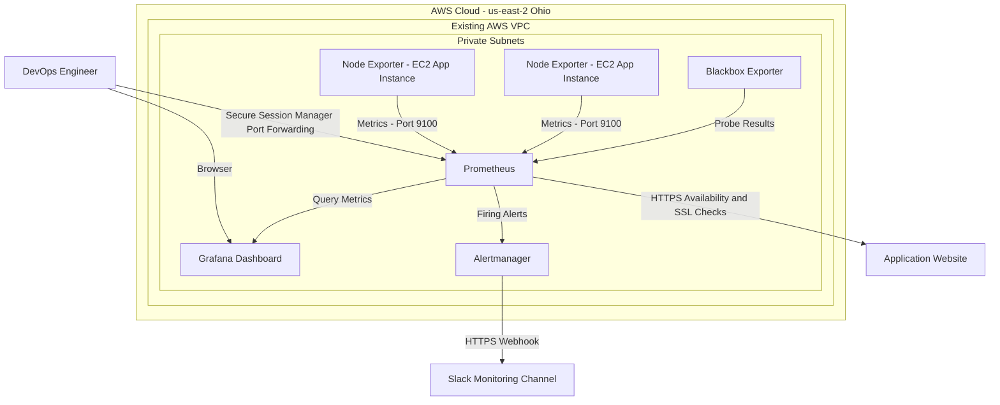
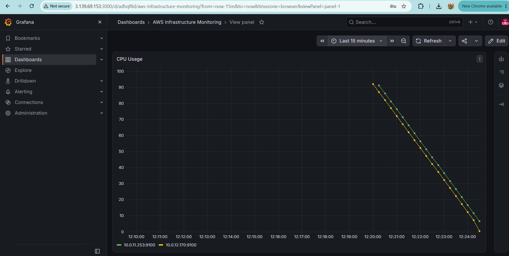
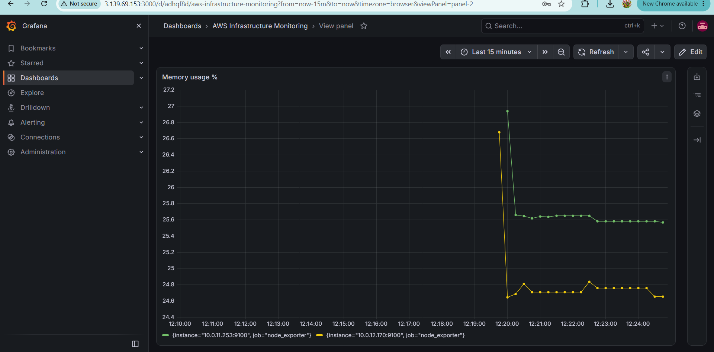
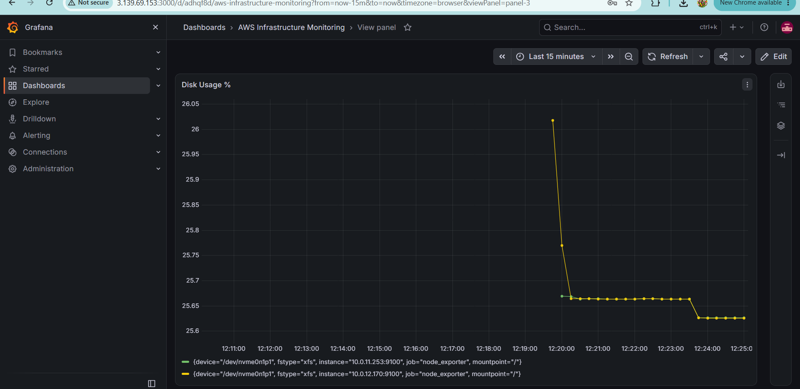
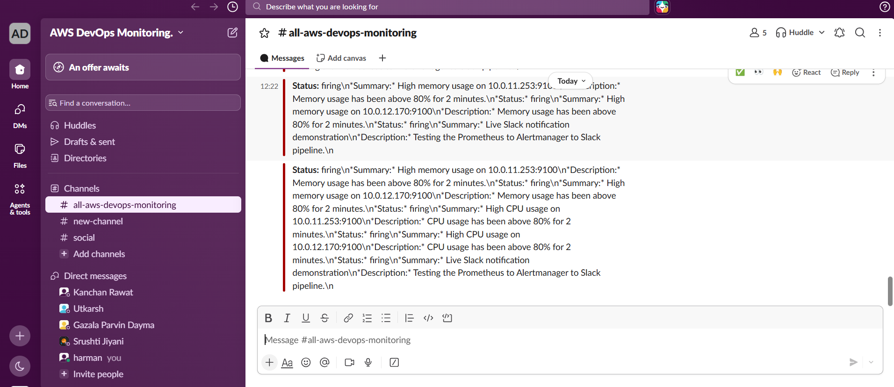

# AWS Infrastructure Monitoring with Prometheus, Grafana, and Slack

## Project Overview

This project implements an AWS infrastructure monitoring and alerting solution using **Prometheus, Grafana, Node Exporter, Blackbox Exporter, Alertmanager, and Slack**.

The goal is to monitor EC2 application instances, visualize infrastructure metrics, check website HTTPS availability and SSL certificate expiration, and deliver automated alerts to Slack when configured conditions are met.

## Architecture



### Monitoring Workflow

1. **Node Exporter** runs on application EC2 instances and exposes operating system metrics.
2. **Prometheus** collects metrics from configured targets and discovers eligible EC2 instances using AWS EC2 service discovery.
3. **Grafana** queries Prometheus and displays infrastructure metrics through dashboards.
4. **Blackbox Exporter** checks the configured website's HTTPS availability and SSL certificate information.
5. **Prometheus alert rules** evaluate configured conditions for CPU, memory, target availability, and SSL certificate expiration.
6. **Alertmanager** routes firing and resolved alerts to a dedicated Slack channel through an incoming webhook.
7. **AWS Systems Manager Session Manager** provides a private access method for administrative access to Prometheus and Alertmanager.

## Technologies Used

| Technology | Purpose |
|---|---|
| Amazon EC2 | Hosts monitoring and application components |
| Amazon VPC | Provides network isolation and private connectivity |
| AWS IAM | Grants required permissions for EC2 discovery and Systems Manager |
| AWS Systems Manager | Enables secure administrative access |
| Prometheus | Metrics collection, querying, and alert-rule evaluation |
| Node Exporter | Collects Linux system metrics |
| Grafana | Monitoring dashboards and visualization |
| Blackbox Exporter | Website HTTPS and SSL certificate checks |
| Alertmanager | Alert routing, grouping, and notification delivery |
| Slack | Receives monitoring alerts |
| Amazon EC2 Auto Scaling | Replaces and manages application instances |

## Key Features

- **Infrastructure monitoring:** CPU, memory, and filesystem usage.
- **EC2 target monitoring:** Tracks whether configured Node Exporter targets are responding to Prometheus scrapes.
- **Dynamic EC2 discovery:** Identifies eligible application instances without relying on fixed instance IP addresses.
- **Website monitoring:** Checks HTTPS endpoint availability using Blackbox Exporter.
- **SSL certificate monitoring:** Evaluates certificate expiration thresholds.
- **Automated alerting:** Routes configured Prometheus alerts through Alertmanager to Slack.
- **Grafana dashboards:** Presents monitoring data in a centralized visual dashboard.
- **Private access:** Keeps Prometheus and Alertmanager administrative interfaces off the public internet.
- **Auto Scaling awareness:** Supports monitoring application instances that may be replaced by the Auto Scaling Group.

## Configured Alert Rules

| Alert | Example condition | Purpose |
|---|---|---|
| HighCPUUsage | CPU usage above 80% for 2 minutes | Identifies sustained high CPU usage |
| HighMemoryUsage | Memory usage above 80% for 2 minutes | Identifies high memory consumption |
| InstanceDown | Node Exporter target reports `up == 0` for 1 minute | Identifies an unreachable monitoring target |
| SSLCertificateExpiringSoon | Certificate expires in fewer than 30 days | Provides advance warning |
| SSLCertificateExpiryCritical | Certificate expires in fewer than 7 days | Highlights an approaching expiration |
| DemoSlackNotification | Test rule using `vector(1)` | Tests the Slack notification workflow |

**Note:** The thresholds above describe the configured example rules. A Node Exporter target reporting `up == 0` means Prometheus cannot successfully scrape that target; it does not, by itself, prove that the EC2 instance has stopped.

The demo notification rule is intended for testing. Disable or remove it when continuous test notifications are no longer required.

## Grafana Dashboard

The Grafana dashboard is designed to display:

- CPU utilization by monitored instance.
- Memory utilization by monitored instance.
- Filesystem usage.
- Node Exporter target availability.
- Historical metric trends for troubleshooting.

Add your actual screenshots below as you upload them to the repository.

### CPU Monitoring




### Memory Monitoring



### Disk Monitoring



### Slack Alerts



## Security Considerations

- Do not expose Prometheus port `9090` or Alertmanager port `9093` publicly.
- Allow Grafana port `3000` only from a trusted administrator IP address or through an approved private access method.
- Allow Node Exporter port `9100` only from the Prometheus security group.
- Keep Blackbox Exporter port `9115` restricted to local access when external access is unnecessary.
- Follow the principle of least privilege for IAM roles and policies.
- Store Slack webhook URLs and other secrets securely. Never commit credentials, access keys, private keys, or webhook URLs to GitHub.
- Use HTTPS and appropriately restricted security group rules wherever applicable.
- Review AWS resource costs and stop or scale down resources when they are not required for testing.

## Repository Structure

```text
aws-prometheus-grafana-slack-monitoring/
├── README.md
├── architecture/
│   └── monitoring-architecture.png
├── screenshots/
│   ├── grafana-cpu.png
│   ├── grafana-memory.png
│   ├── grafana-disk.png
│   └── slack-alerts.png
└── config/
    ├── prometheus.yml.example
    └── alert_rules.yml.example
```

The folders and image files above are the planned documentation structure. Add each file before referencing it as an existing repository asset. Configuration examples must not contain credentials or webhook secrets.

## Skills Demonstrated

- AWS infrastructure monitoring and troubleshooting.
- Prometheus configuration and metrics collection.
- PromQL queries and alert-rule configuration.
- Grafana data source and dashboard configuration.
- Linux systemd service management.
- AWS IAM permissions and EC2 service discovery.
- AWS security groups and private network access.
- SSL certificate and website availability monitoring.
- Alertmanager routing and Slack integration.
- Monitoring application instances in an Auto Scaling environment.
- Technical documentation and GitHub project management.

## Project Outcome

This project demonstrates how infrastructure metrics, dashboard visualization, website health checks, and automated notifications can be combined into a centralized monitoring solution for an AWS-hosted application.

It also demonstrates practical DevOps skills in observability, alerting, access control, troubleshooting, and operational monitoring.

## Author

**GitHub:** [harman0726](https://github.com/harman0726)

**Repository:** [aws-prometheus-grafana-slack-monitoring](https://github.com/harman0726/aws-prometheus-grafana-slack-monitoring)
